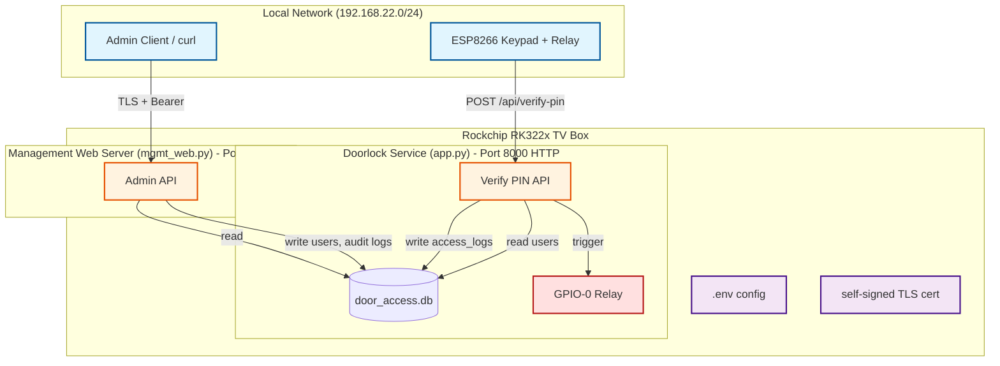

# PRD — Door Access Control System v2.0

**Document ID:** PRD-DOORLOCK-2026-001  
**Version:** 2.0  
**Status:** Approved for implementation  
**Platform:** Rockchip RK322x TV box (ARM Cortex-A7, Linux/Armbian)  
**Services:** Doorlock Service (`app.py`), Management Web Server (`mgmt_web.py`), ESP8266 Keypad Firmware  
**Database:** SQLite (`door_access.db`)  
**Python Tooling:** UV + `pyproject.toml`

---

## 1. Executive Summary

The Door Access Control System grants physical door entry based on a numeric PIN entered via an ESP8266 keypad. The current v1 implementation has critical security and operational weaknesses: hardcoded admin tokens, unsalted SHA-256 PIN hashes, in-memory-only rate limiting, plaintext HTTP, and no separation between door control and user management.

**v2.0 introduces a strict separation of concerns:**
- **Doorlock Service (`app.py`)**: Local-only service that verifies PINs from the ESP8266 and triggers the relay. It **reads** user credentials but **never writes** to the `users` table.
- **Management Web Server (`mgmt_web.py`)**: A detached web server, the **sole entity authorized to modify** the doorlock database (users, PINs, active status). It runs behind self-signed TLS and accepts admin requests only.
- **No other client** — even from the same local network — may modify user data or doorlock state. All user management flows through `mgmt-web`.

---

## 2. Goals & Objectives

| ID | Goal | Success Measure |
|----|------|-----------------|
| G-1 | Confidentiality: PINs and admin credentials never travel in plaintext | 100% of management traffic over TLS |
| G-2 | Integrity: Only the Management Web Server can alter `users` data | Zero unauthorized DB write paths |
| G-3 | Availability: Door unlock works locally even if the management server is down | ESP8266 ↔ Doorlock Service remains functional |
| G-4 | Auditability: Every access grant/deny and every admin action is logged | Immutable append-only logs |
| G-5 | Operability: Reproducible deployments via `.env` + `pyproject.toml` + UV | Fresh install in < 10 minutes |

---

## 3. Scope

### 3.1 In Scope
- Doorlock Service (Quart + Hypercorn) on port `8000` (HTTP, LAN/local only)
- Management Web Server (Quart + Hypercorn) on port `8443` (TLS self-signed, localhost/VPN only)
- SQLite database `door_access.db` with WAL mode and persistent tables
- ESP8266 Arduino firmware (non-blocking relay, ArduinoJSON, WiFi reconnect)
- `.env` configuration for all secrets, IPs, and feature toggles

---

## 4. Architecture

### 4.1 System Context Diagram (Mermaid)



### 4.2 Network & Trust Boundaries

| Boundary | Direction | Protocol | Auth |
|----------|-----------|----------|------|
| ESP8266 → Doorlock Service | Inbound | HTTP (port 8000) | None (PIN in body) |
| Doorlock Service → SQLite | Local | SQLite | File permissions |
| Admin Client → Management Web Server | Inbound | HTTPS (port 8443, self-signed) | Bearer token (`ADMIN_SECRET_TOKEN`) |
| Management Web Server → SQLite | Local | SQLite | File permissions |
| Doorlock Service → Management Web Server | None | — | — (no direct coupling) |

**Rule:** The Doorlock Service binds to `0.0.0.0:8000` for the ESP8266 but exposes **only** `/api/verify-pin` and `/api/health`. The Management Web Server binds to `127.0.0.1:8443` (or a VPN interface) and is the **only** service allowed to `INSERT/UPDATE/DELETE` on the `users` table.
- `pyproject.toml` with pinned dependencies managed by UV
- systemd unit files for both services
- Self-signed TLS certificate generation for `mgmt-web`
- Migration path from v1 (SHA-256 → argon2, default user handling)

### 3.2 Out of Scope
- Direct writes to `door_access.db` from Doorlock Service `users` table (read-only for users)
- Remote/unauthenticated door unlock from the internet
- Mobile app or web dashboard for end users (v2 is API-only)
- Hardware GPIO control from the Management Web Server (relay remains local to Doorlock Service)
- Database replication or multi-node deployment

---

## 5. Components & Responsibilities

### 5.1 Doorlock Service (`app.py`)
- **Purpose:** Verify PINs from the ESP8266 and trigger the physical relay.
- **Database access:** `SELECT` on `users`; `INSERT` on `access_logs` and `failed_attempts`. **No write access to `users`.**
- **Endpoints:**
  - `POST /api/verify-pin` — credential verification (ESP8266)
  - `GET /api/health` — service + DB connectivity health
- **Rate limiting:** Persistent, per `username + IP`, stored in `failed_attempts` table (survives restarts).
- **PIN verification:** Constant-time comparison of `argon2` hashes.
- **Config:** `.env` for DB path, bind host/port, relay GPIO pin, rate-limit thresholds.

### 5.2 Management Web Server (`mgmt_web.py`)
- **Purpose:** Sole writer of user identity data. Detached from door control.
- **Database access:** Full CRUD on `users`; `INSERT` on `admin_audit_logs`; read on `access_logs`.
- **Endpoints:** All require `Authorization: Bearer <ADMIN_SECRET_TOKEN>` over TLS.
  - `POST /api/v1/admin/users` — create user
  - `GET /api/v1/admin/users` — list users
  - `GET /api/v1/admin/users/{username}` — get user
  - `DELETE /api/v1/admin/users/{username}` — soft-delete (set `is_active = 0`)
  - `PUT /api/v1/admin/users/{username}/pin` — change PIN (argon2 re-hash)
  - `GET /api/v1/admin/audit-logs` — admin action history
- **Network:** TLS only (self-signed certificate), localhost or VPN interface.
- **Config:** `.env` for admin token, TLS cert paths, bind address, DB path.

### 5.3 Database (`door_access.db`)
Single SQLite file shared by both services via file-level locking (WAL mode).

### 5.4 ESP8266 Firmware
- WiFi credentials and API URL loaded from compile-time or secure storage (`.env` values baked at build time).
- Non-blocking relay timing (`millis()` state machine).
- ArduinoJSON for request/response serialization.
- Distinct handling of `200`, `401`, `429`, and connection errors.
- Automatic WiFi reconnection.

### 5.5 Configuration (`.env`)
All secrets and environment-specific values live in `.env` (never committed):
```
# Doorlock Service
DOORLOCK_HOST=0.0.0.0
DOORLOCK_PORT=8000
DOORLOCK_DB_PATH=/mnt/remote/door_access.db
RELAY_GPIO=0
RELAY_ACTIVE_MS=3000
RATE_LIMIT_MAX_FAIL=3
RATE_LIMIT_BASE_PENALTY_S=30

# Management Web Server
MGMT_HOST=127.0.0.1
MGMT_PORT=8443
MGMT_TLS_CERT=/mnt/remote/certs/mgmt-web.crt
MGMT_TLS_KEY=/mnt/remote/certs/mgmt-web.key
ADMIN_SECRET_TOKEN=<strong-random-token>

# Shared
ARGON2_TIME_COST=3
ARGON2_MEMORY_COST=65536
ARGON2_PARALLELISM=4

# ESP8266 (baked into firmware at build)
ESP_WIFI_SSID=<ssid>
ESP_WIFI_PASSWORD=<pass>
ESP_API_URL=http://192.168.22.13:8000/api/verify-pin
```

---

## 6. Functional Requirements

| ID | Requirement | Priority |
|----|-------------|----------|
| FR-001 | Doorlock Service verifies PIN via `POST /api/verify-pin` from ESP8266 only. | Must |
| FR-002 | Doorlock Service triggers relay for 3 s on successful PIN verification. | Must |
| FR-003 | Doorlock Service logs every attempt (GRANTED/DENIED) to `access_logs` with timestamp, username, IP. | Must |
| FR-004 | Management Web Server is the **only** service that can `INSERT/UPDATE/DELETE` on `users`. | Must |
| FR-005 | Management Web Server rejects all requests without valid `Authorization: Bearer <token>` over TLS. | Must |
| FR-006 | PINs are hashed with **argon2** (per-user salt, configurable cost) before storage. | Must |
| FR-007 | Admin token comparison uses constant-time comparison (`hmac.compare_digest`). | Must |
| FR-008 | Failed attempts are tracked persistently per `username + IP` in `failed_attempts`; lockout survives restart. | Must |
| FR-009 | After N consecutive failures, the account/IP is locked for an escalating duration (30s, 60s, 120s…). | Must |
| FR-010 | Successful authentication clears the failure counter for that `username + IP`. | Must |
| FR-011 | Users are soft-deleted (`is_active = 0`, `revoked_at`, `revoked_by`) — no hard deletes. | Must |
| FR-012 | Every admin action is appended to `admin_audit_logs` (actor, action, target, timestamp, IP). | Must |
| FR-013 | Doorlock Service exposes `GET /api/health` returning DB connectivity and service status. | Should |
| FR-014 | Management Web Server exposes `GET /api/v1/admin/access-logs` for read-only audit viewing. | Should |
| FR-015 | ESP8266 handles `429` (locked out) by displaying wait time and not triggering relay. | Must |
| FR-016 | ESP8266 reconnects to WiFi automatically if connection drops. | Must |
| FR-017 | ESP8266 relay uses non-blocking timing so keypad input remains responsive during unlock. | Must |
| FR-018 | All raw exceptions are logged server-side; clients receive generic error messages only. | Must |
| FR-019 | Username input is validated (length, charset, no SQL injection vectors). | Must |
| FR-020 | PIN input is validated (min length 8, max length 64, no empty/whitespace-only). | Must |

---

## 7. Non-Functional Requirements

| Category | ID | Requirement |
|----------|----|-------------|
| Security | NFR-1 | No plaintext transmission of PINs or admin tokens (management over TLS) |
| Security | NFR-2 | No hardcoded secrets in source code; all from `.env` |
| Reliability | NFR-3 | Door unlock works if Management Web Server is offline (local path only) |
| Reliability | NFR-4 | Services restart automatically via systemd (`Restart=always`) |
| Reliability | NFR-5 | SQLite in WAL mode with `busy_timeout` to avoid "database is locked" under concurrency |
| Performance | NFR-6 | Production ASGI server: Hypercorn (not Quart dev server) |
| Observability | NFR-7 | Structured JSON access logs; journald integration via systemd |
| Maintainability | NFR-8 | `pyproject.toml` with pinned versions managed by UV; reproducible venv |
| Maintainability | NFR-9 | Database migration script for v1 → v2 (hash migration, new tables) |
| Compatibility | NFR-10 | ESP8266 firmware compiles with Arduino ESP8266 core + ArduinoJSON |

---

## 8. Security Requirements

| ID | Requirement |
|----|-------------|
| SR-001 | Management Web Server enforces TLS 1.2+ with self-signed certificate; HTTP redirected/rejected |
| SR-002 | `ADMIN_SECRET_TOKEN` minimum 32 characters, randomly generated, stored only in `.env` |
| SR-003 | Constant-time comparison for admin token and PIN hash verification |
| SR-004 | Rate limiting is per `username + IP`, persistent in SQLite, not reset by service restart |
| SR-005 | Doorlock Service binds to `0.0.0.0:8000` but exposes only verification endpoints; no admin endpoints |
| SR-006 | Management Web Server binds to `127.0.0.1:8443` (or VPN interface only) — not exposed to LAN/WAN directly |
| SR-007 | Raw database/system errors never returned in HTTP response body; logged internally |
| SR-008 | `users.pin_hash` column stores argon2 hashes only; legacy SHA-256 hashes migrated on first login |
| SR-009 | File permissions on `door_access.db`: owner read/write only (`0600`) |
| SR-010 | `.env` file permissions `0600`, excluded from version control |

---

## 9. Data Model

### 9.1 Tables

```sql
-- Users: identity data. WRITE access restricted to Management Web Server.
CREATE TABLE IF NOT EXISTS users (
    id INTEGER PRIMARY KEY AUTOINCREMENT,
    username TEXT NOT NULL UNIQUE,
    pin_hash TEXT NOT NULL,           -- argon2 hash
    is_active INTEGER DEFAULT 1,
    created_at DATETIME DEFAULT CURRENT_TIMESTAMP,
    updated_at DATETIME DEFAULT CURRENT_TIMESTAMP,
    revoked_at DATETIME,
    revoked_by TEXT
);

-- Access logs: door access events. Doorlock Service writes; Management Web Server reads.
CREATE TABLE IF NOT EXISTS access_logs (
    id INTEGER PRIMARY KEY AUTOINCREMENT,
    timestamp DATETIME DEFAULT CURRENT_TIMESTAMP,
    username TEXT,
    status TEXT NOT NULL,             -- GRANTED / DENIED
    ip_address TEXT,
    reason TEXT
);

-- Persistent failed attempts: rate limiting state surviving restarts.
CREATE TABLE IF NOT EXISTS failed_attempts (
    id INTEGER PRIMARY KEY AUTOINCREMENT,
    username TEXT NOT NULL,
    ip_address TEXT NOT NULL,
    failed_count INTEGER DEFAULT 0,
    lockout_until DATETIME,
    updated_at DATETIME DEFAULT CURRENT_TIMESTAMP,
    UNIQUE(username, ip_address)
);

-- Admin audit log: every management action.
CREATE TABLE IF NOT EXISTS admin_audit_logs (
    id INTEGER PRIMARY KEY AUTOINCREMENT,
    timestamp DATETIME DEFAULT CURRENT_TIMESTAMP,
    actor TEXT NOT NULL,
    action TEXT NOT NULL,
    target_username TEXT,
    ip_address TEXT,
    details TEXT
);

-- Indexes
CREATE INDEX IF NOT EXISTS idx_access_logs_username ON access_logs(username);
CREATE INDEX IF NOT EXISTS idx_access_logs_timestamp ON access_logs(timestamp);
CREATE INDEX IF NOT EXISTS idx_failed_attempts_lookup ON failed_attempts(username, ip_address);
CREATE INDEX IF NOT EXISTS idx_users_active ON users(is_active);
```

### 9.2 Database Hardening
- `PRAGMA journal_mode=WAL`
- `PRAGMA busy_timeout=30000`
- `PRAGMA foreign_keys=ON`

---

## 10. API Specification

### 10.1 Doorlock Service — `http://<host>:8000`

| Method | Endpoint | Auth | Description |
|--------|----------|------|-------------|
| `POST` | `/api/verify-pin` | None | Verify username+PIN from ESP8266 |
| `GET`  | `/api/health` | None | Health check |

**`POST /api/verify-pin` request:**
```json
{ "username": "5551234", "pin": "87654321" }
```

**Responses:**
- `200` — `{ "status": "granted", "user": "5551234" }` → ESP8266 triggers relay
- `401` — `{ "status": "denied", "reason": "Invalid credentials" }`
- `429` — `{ "status": "denied", "reason": "Locked out. Wait 30s." }`
- `400` — `{ "status": "rejected", "reason": "Invalid payload" }`

### 10.2 Management Web Server — `https://127.0.0.1:8443`

All endpoints require `Authorization: Bearer <ADMIN_SECRET_TOKEN>` over TLS.

| Method | Endpoint | Description |
|--------|----------|-------------|
| `POST` | `/api/v1/admin/users` | Create user (`{username, pin}`) |
| `GET`  | `/api/v1/admin/users` | List all users |
| `GET`  | `/api/v1/admin/users/<username>` | Get user details |
| `PUT`  | `/api/v1/admin/users/<username>/pin` | Change PIN |
| `DELETE` | `/api/v1/admin/users/<username>` | Soft-revoke user |
| `GET`  | `/api/v1/admin/access-logs` | Read access logs |
| `GET`  | `/api/v1/admin/audit-logs` | Read admin audit logs |